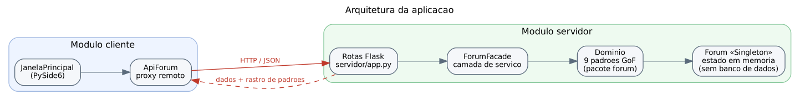
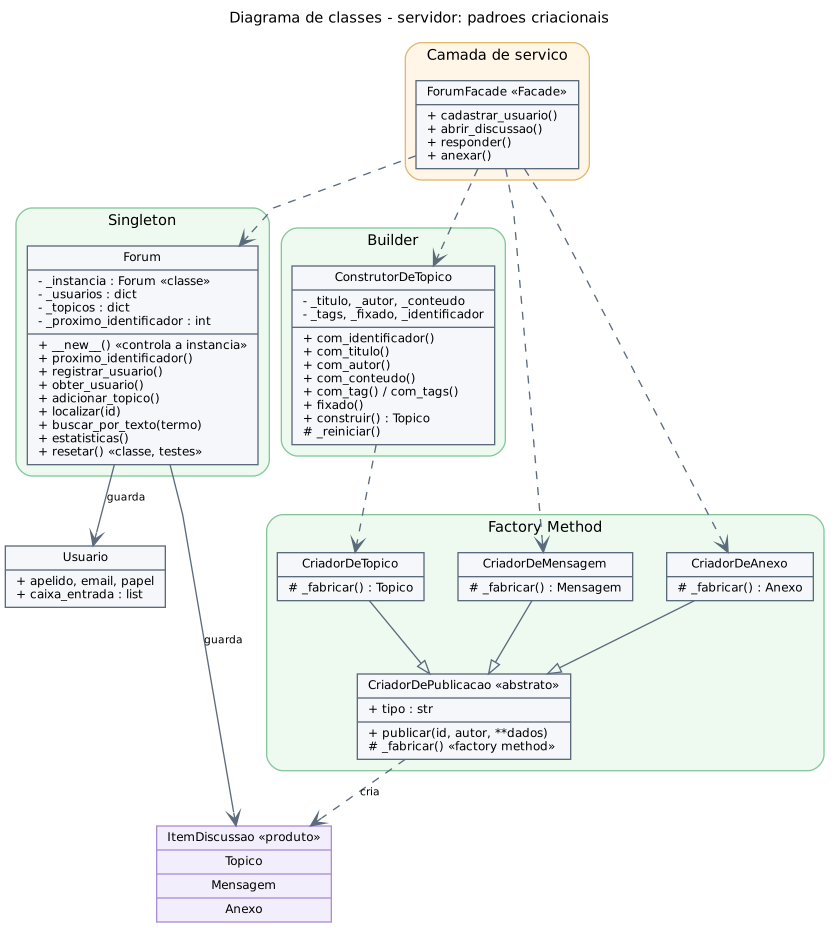
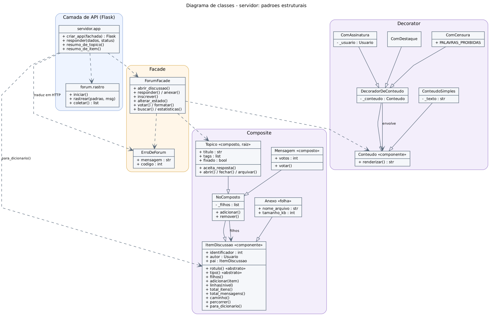
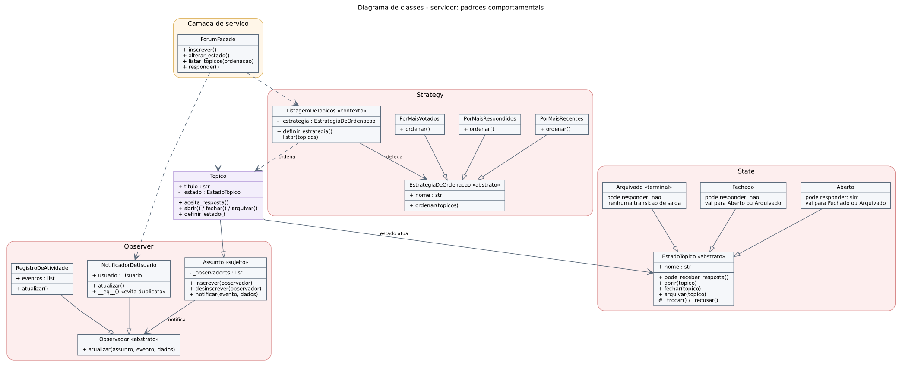
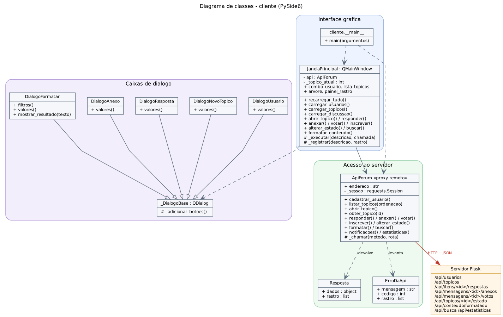
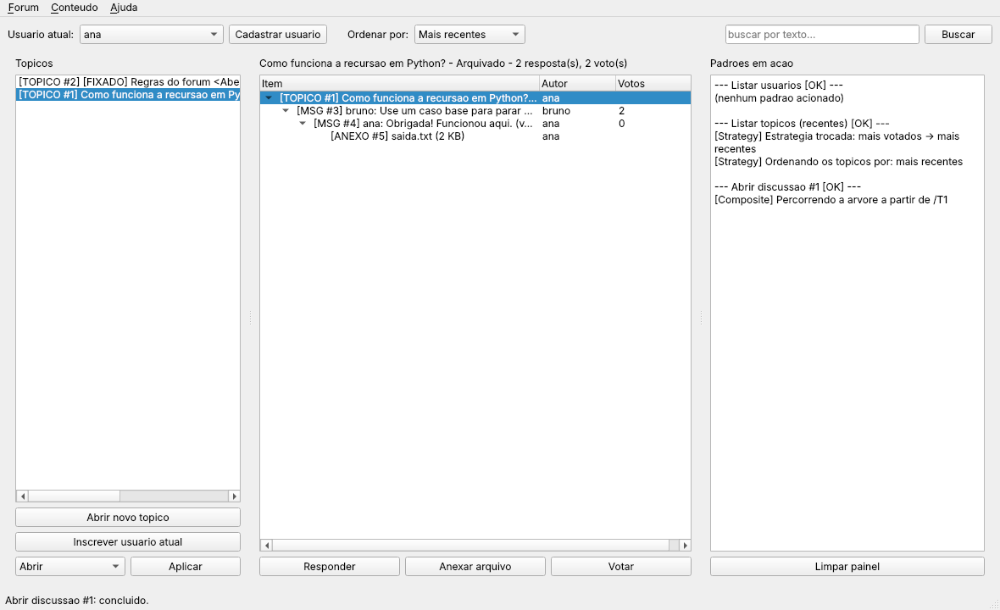
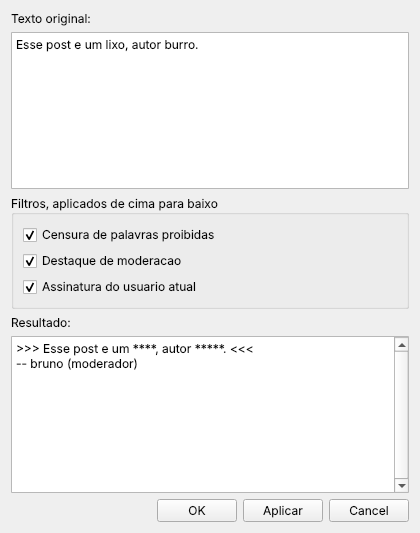

# Fórum de Discussão

Projeto de Design Patterns — Paradigmas de Programação, turma CC5AN

Aplicação cliente/servidor: servidor **Flask** expondo a API e cliente gráfico em **Qt (PySide6)**, com nove padrões de projeto do catálogo GoF aplicados ao domínio de um fórum de discussão.

***

## 1. Visão geral

O sistema é um fórum de discussão dividido em dois módulos independentes:

- **servidor** — aplicação Flask que guarda o estado do fórum em memória e expõe um endpoint para cada recurso (usuários, tópicos, respostas, anexos, votos, inscrições, estado, formatação de conteúdo, busca e estatísticas);
- **cliente** — aplicação gráfica em PySide6 que consome esses endpoints. O cliente não contém regra de negócio: toda decisão acontece no servidor.

O domínio do fórum concentra nove padrões GoF, três de cada categoria. Para tornar o funcionamento deles visível durante a demonstração, **toda resposta do servidor traz um rastro** com as linhas dos padrões acionados naquela requisição, e o cliente exibe esse rastro em um painel lateral chamado *Padrões em ação*.

Nenhum banco de dados, API de terceiros, serviço de nuvem ou serviço de IA é utilizado. O estado vive na instância única de `Forum` (padrão Singleton) enquanto o servidor estiver em execução.

### 1.1 Padrões implementados

| # | Padrão | Categoria | Arquivo | Papel no fórum |
|---|--------|-----------|---------|----------------|
| 1 | Singleton | Criacional | `forum/criacional/singleton.py` | Repositório único: usuários, tópicos e contador de identificadores |
| 2 | Factory Method | Criacional | `forum/criacional/factory_method.py` | Roteiro único de publicação que fabrica Tópico, Mensagem ou Anexo |
| 3 | Builder | Criacional | `forum/criacional/builder.py` | Montagem passo a passo de um tópico (título, autor, texto, tags, fixado) |
| 4 | Composite | Estrutural | `forum/estrutural/composite.py` | Árvore da discussão e sua serialização para JSON |
| 5 | Decorator | Estrutural | `forum/estrutural/decorator.py` | Filtros de conteúdo empilháveis: censura, destaque e assinatura |
| 6 | Facade | Estrutural | `forum/estrutural/facade.py` | Camada de serviço chamada pelas rotas Flask |
| 7 | Observer | Comportamental | `forum/comportamental/observer.py` | Notificação dos inscritos a cada nova resposta |
| 8 | Strategy | Comportamental | `forum/comportamental/strategy.py` | Ordenação da listagem de tópicos |
| 9 | State | Comportamental | `forum/comportamental/state.py` | Ciclo de vida do tópico: Aberto, Fechado e Arquivado |

No lado do cliente, a classe `ApiForum` funciona como um **proxy remoto**: expõe os mesmos métodos da fachada do servidor, mas cada chamada é empacotada em uma requisição HTTP.

### 1.2 Estrutura de diretórios

```
forum-design-patterns/
├── requirements.txt               Flask, requests e PySide6
├── README.md
├── servidor/                      MÓDULO SERVIDOR
│   ├── app.py                     rotas Flask e envelope das respostas
│   └── __main__.py                python -m servidor
├── cliente/                       MÓDULO CLIENTE
│   ├── api.py                     ApiForum: proxy remoto dos endpoints
│   ├── dialogos.py                caixas de diálogo
│   ├── janela.py                  JanelaPrincipal (QMainWindow)
│   └── __main__.py                python -m cliente
├── forum/                         DOMÍNIO (compartilhado pelo servidor)
│   ├── modelos.py                 Usuario
│   ├── rastro.py                  rastro dos padrões por requisição
│   ├── erros.py                   ErroDeForum
│   ├── criacional/                singleton.py, factory_method.py, builder.py
│   ├── estrutural/                composite.py, decorator.py, facade.py
│   └── comportamental/            observer.py, strategy.py, state.py
├── testes/
│   ├── test_padroes.py            33 testes do domínio
│   ├── test_servidor.py           35 testes dos endpoints
│   ├── test_cliente.py            12 testes do acesso do cliente
│   ├── test_cliente_gui.py        10 testes da janela gráfica
│   └── demonstracao.py            roteiro da aplicação em uso
└── docs/
    ├── DOCUMENTACAO.md            este documento
    ├── gerar_diagramas.py         regera os diagramas
    └── imagens/                   diagramas e capturas de tela
```

### 1.3 Como executar

```
pip install -r requirements.txt

python -m servidor        # terminal 1: servidor em http://127.0.0.1:5000
python -m cliente         # terminal 2: cliente gráfico
```

O cliente aceita outro endereço como argumento: `python -m cliente http://127.0.0.1:5050`.

Demais comandos:

```
python -m unittest discover -s testes -v     # 90 testes automatizados
python testes/demonstracao.py                # roteiro da aplicação em uso
python testes/demonstracao.py --sem-gui      # somente o roteiro HTTP
python docs/gerar_diagramas.py               # regera os diagramas de classes
```

Requisitos de ambiente: Python 3.9 ou superior e as três dependências de `requirements.txt`.

***

## 2. Requisitos

### 2.1 Requisitos funcionais

| ID | Requisito | Endpoint | Onde aparece no cliente |
|----|-----------|----------|-------------------------|
| RF01 | Cadastrar participante com apelido, e-mail e papel (membro ou moderador) | `POST /api/usuarios` | Botão *Cadastrar usuário* |
| RF02 | Listar os participantes cadastrados | `GET /api/usuarios` | Seletor *Usuário atual* |
| RF03 | Abrir um tópico informando título, texto, tags e sinalização de fixado | `POST /api/topicos` | Botão *Abrir novo tópico* |
| RF04 | Listar os tópicos com ordenação escolhida pelo usuário | `GET /api/topicos?ordenacao=` | Seletor *Ordenar por* |
| RF05 | Exibir a árvore completa de uma discussão, em qualquer profundidade | `GET /api/topicos/<id>` | Painel central em árvore |
| RF06 | Responder a um tópico ou a uma mensagem já existente | `POST /api/itens/<id>/respostas` | Botão *Responder* |
| RF07 | Anexar arquivo a uma mensagem | `POST /api/mensagens/<id>/anexos` | Botão *Anexar arquivo* |
| RF08 | Registrar voto em uma mensagem | `POST /api/mensagens/<id>/votos` | Botão *Votar* |
| RF09 | Inscrever um participante em um tópico | `POST /api/topicos/<id>/inscricoes` | Botão *Inscrever usuário atual* |
| RF10 | Notificar os inscritos a cada nova resposta | — (efeito de RF06) | *Fórum → Notificações* |
| RF11 | Abrir, fechar ou arquivar um tópico | `PUT /api/topicos/<id>/estado` | Seletor de estado + *Aplicar* |
| RF12 | Aplicar filtros combináveis a um texto antes de publicá-lo | `POST /api/conteudo/formatado` | *Conteúdo → Formatar texto* |
| RF13 | Buscar por texto em todas as árvores de discussão | `GET /api/busca?termo=` | Campo de busca |
| RF14 | Apresentar os números gerais do fórum | `GET /api/estatisticas` | *Fórum → Estatísticas* |
| RF15 | Informar, a cada operação, quais padrões de projeto foram acionados | campo `rastro` de toda resposta | Painel *Padrões em ação* |

### 2.2 Requisitos não-funcionais

| ID | Requisito |
|----|-----------|
| RNF01 | A aplicação roda sem banco de dados, API de terceiros, serviço de nuvem ou serviço de IA; o estado vive em memória no processo do servidor |
| RNF02 | O repositório é executável após `pip install -r requirements.txt`, sem nenhuma outra configuração |
| RNF03 | Servidor e cliente são módulos independentes e comunicam-se apenas por HTTP com corpo JSON |
| RNF04 | O cliente não contém regra de negócio: toda validação e toda decisão ocorrem no servidor |
| RNF05 | Toda resposta segue o mesmo envelope `{"dados": ..., "rastro": [...]}`, e todo erro devolve `{"erro": ..., "rastro": [...]}` com o status HTTP adequado |
| RNF06 | O domínio não depende do Flask nem do Qt, e pode ser testado isoladamente |
| RNF07 | Cada padrão de projeto fica em seu próprio módulo, com intenção, aplicação e participantes documentados no cabeçalho |
| RNF08 | A suíte automatizada cobre domínio, endpoints, acesso do cliente e interface gráfica, e roda sem abrir janelas |
| RNF09 | O cliente informa falha de comunicação com o servidor em linguagem compreensível, sem encerrar a aplicação |
| RNF10 | Código, mensagens de interface e documentação em português |

### 2.3 Condições de aceitação

| ID | Condição | Verificado por |
|----|----------|----------------|
| CA01 | Subir o servidor e o cliente em duas linhas de comando, sem configuração adicional | Seção 1.3 |
| CA02 | Dois participantes com o mesmo apelido não são aceitos; a segunda tentativa devolve HTTP 409 | `TesteUsuarios.test_apelido_duplicado` |
| CA03 | Somente moderadores conseguem fixar um tópico; um membro recebe HTTP 403 | `TesteTopicos.test_membro_nao_fixa` / `test_moderador_fixa` |
| CA04 | Uma resposta a uma mensagem aparece aninhada sob ela na árvore, e não no nível do tópico | `TesteRespostasEAnexos.test_resposta_aninhada` |
| CA05 | Um anexo não aceita filhos: a tentativa devolve HTTP 400 | `TesteRespostasEAnexos.test_anexo_em_anexo_e_recusado` |
| CA06 | Tópico fechado recusa novas respostas com HTTP 409 | `TesteEstadoEObserver.test_fechar_bloqueia_resposta` |
| CA07 | Tópico arquivado não pode ser reaberto, e permanece arquivado | `TesteEstadoEObserver.test_arquivado_nao_reabre` |
| CA08 | Quem está inscrito em um tópico recebe aviso na caixa de entrada a cada nova resposta | `TesteEstadoEObserver.test_inscricao_e_notificacao` |
| CA09 | Trocar a ordenação muda a ordem da listagem sem alterar os dados | `TesteTopicos.test_ordenacao_por_votos` |
| CA10 | Os filtros de conteúdo são aplicados de dentro para fora e podem ser combinados | `TesteConteudoEConsultas.test_formatacao_com_pilha_de_filtros` |
| CA11 | A busca encontra itens em qualquer nível da árvore e informa o caminho | `TesteConteudoEConsultas.test_busca_encontra_na_arvore` |
| CA12 | Toda resposta traz o rastro dos padrões, e o rastro de uma requisição não vaza para a seguinte | `TesteEnvelope` |
| CA13 | A árvore exibida pelo cliente reflete a estrutura recebida do servidor | `TesteJanelaPrincipal.test_arvore_reflete_a_estrutura_recebida` |
| CA14 | Com o servidor fora do ar, o cliente avisa o usuário e continua aberto | `TesteJanelaPrincipal.test_falha_de_servidor_mostra_aviso` |
| CA15 | A suíte automatizada completa passa sem falhas | Seção 8 |

***

## 3. Arquitetura

O cliente conversa apenas com `ApiForum`; `ApiForum` conversa apenas com os endpoints; as rotas conversam apenas com `ForumFacade`; e a fachada coordena os nove padrões. Cada camada conhece somente a seguinte.



### 3.1 Diagramas de classes — servidor

O servidor é apresentado em três diagramas, um por categoria de padrão, para que as assinaturas fiquem legíveis. A visão completa, com os nove padrões em um único diagrama, está em `docs/imagens/servidor-classes.png` e na versão vetorial `servidor-classes.svg`.

**Padrões criacionais** — o repositório único, a montagem do tópico e a fabricação dos produtos:



**Padrões estruturais** — a camada de API, a fachada, a árvore da discussão e os filtros de conteúdo:



**Padrões comportamentais** — notificações, ordenação e ciclo de vida do tópico:



### 3.2 Diagrama de classes — cliente



***
## 4. Os nove padrões aplicados ao fórum

### 4.1 Singleton (criacional)

**Intenção.** Garantir que uma classe tenha uma única instância e fornecer um ponto global de acesso a ela.

**Problema no fórum.** O cadastro de usuários, a coleção de tópicos e o contador de identificadores precisam ser únicos no processo do servidor. Se cada requisição criasse o seu próprio objeto `Forum`, dois tópicos poderiam receber o identificador `#1` e um usuário cadastrado em uma chamada não existiria na seguinte.

**Implementação.** O controle fica em `__new__`: a primeira chamada cria o objeto e o guarda em `Forum._instancia`; as seguintes devolvem o mesmo objeto. O método de classe `resetar()` existe apenas para isolar os testes automatizados, que precisam de um fórum limpo a cada caso.

**Como verificar.** O endpoint `GET /api/estatisticas` devolve o campo `instancia_unica`, calculado comparando `Forum()` com a instância que a fachada já usa.

### 4.2 Factory Method (criacional)

**Intenção.** Definir uma interface para criar um objeto, deixando que as subclasses decidam qual classe instanciar.

**Problema no fórum.** Publicar um item segue sempre o mesmo roteiro — anunciar, fabricar, confirmar — mas o produto varia: `Topico`, `Mensagem` ou `Anexo`.

**Implementação.** `CriadorDePublicacao.publicar()` concentra o roteiro comum e chama `_fabricar()`, o Factory Method, sobrescrito por `CriadorDeTopico`, `CriadorDeMensagem` e `CriadorDeAnexo`. O dicionário `CRIADORES` permite obter o criador pelo nome do tipo, sem encadeamento de `if`.

### 4.3 Builder (criacional)

**Intenção.** Separar a construção de um objeto complexo da sua representação.

**Problema no fórum.** Abrir um tópico envolve cinco informações, sendo três opcionais (texto de abertura, tags e sinalização de fixado). Um construtor com cinco parâmetros posicionais seria ilegível e frágil, e o corpo JSON da requisição pode omitir qualquer uma delas.

**Implementação.** `ConstrutorDeTopico` expõe métodos encadeáveis (`com_titulo`, `com_autor`, `com_tags`, `fixado`), valida o que é obrigatório em `construir()` e só então delega a fabricação ao Factory Method. Depois de entregar o produto, o construtor se reinicia, evitando que sobras de uma requisição vazem para a próxima.

### 4.4 Composite (estrutural)

**Intenção.** Compor objetos em estruturas de árvore e tratar objetos individuais e composições de maneira uniforme.

**Problema no fórum.** Uma discussão é uma árvore: o tópico contém mensagens, cada mensagem contém respostas e anexos, sem limite de profundidade. Exibir, contar, percorrer e **serializar para JSON** precisam funcionar igual em qualquer nível.

**Implementação.** `ItemDiscussao` é o componente e define `linhas()`, `total_itens()`, `caminho()`, `percorrer()` e `para_dicionario()` de forma recursiva. `Anexo` é a folha e recusa filhos com `TypeError`; `Mensagem` e `Topico` são compostos. O método `caminho()` reconstrói o endereço do nó até a raiz (por exemplo `/T1/M3/M4/A5`) usando a referência ao pai.

**No cliente.** `JanelaPrincipal._montar_no()` percorre o mesmo JSON de forma recursiva para montar o `QTreeWidget`: a uniformidade do Composite atravessa a fronteira HTTP.

### 4.5 Decorator (estrutural)

**Intenção.** Anexar responsabilidades a um objeto dinamicamente, como alternativa flexível à herança.

**Problema no fórum.** O texto publicado pode passar por censura de palavras proibidas, destaque de moderação e assinatura do autor, em qualquer combinação e ordem. Criar uma subclasse para cada combinação seria inviável.

**Implementação.** `Conteudo` é o componente, `ConteudoSimples` guarda o texto cru e `DecoradorDeConteudo` envolve outro `Conteudo`. Os decoradores concretos são empilhados em tempo de execução, conforme a lista de filtros que chega no corpo da requisição. A ordem da pilha altera o resultado final, como demonstram a seção 9 e o teste `test_ordem_importa`.

### 4.6 Facade (estrutural)

**Intenção.** Fornecer uma interface unificada para um conjunto de interfaces de um subsistema.

**Problema no fórum.** Abrir uma discussão exige coordenar seis participantes: repositório único, construtor, criador, árvore, observadores e estado inicial. Uma rota HTTP não deve conhecer nada disso.

**Implementação.** `ForumFacade` oferece operações de alto nível (`abrir_discussao`, `responder`, `buscar`, `alterar_estado`) e esconde a coordenação. É a camada de serviço do servidor: cada rota chama um método da fachada e traduz o resultado em JSON. Quando uma regra é violada, a fachada levanta `ErroDeForum` com o status HTTP adequado — o domínio não imprime mensagens nem importa nada do Flask.

### 4.7 Observer (comportamental)

**Intenção.** Definir uma dependência um-para-muitos, de modo que a mudança de estado de um objeto notifique automaticamente seus dependentes.

**Problema no fórum.** Quem acompanha um tópico precisa ser avisado a cada nova resposta, e o tópico não pode depender da forma de entrega do aviso.

**Implementação.** `Topico` herda de `Assunto` e mantém a lista de observadores. `NotificadorDeUsuario` entrega o aviso na caixa de entrada de um usuário; `RegistroDeAtividade` grava o evento para auditoria. Os dois implementam a mesma interface `Observador`, e o tópico não sabe a diferença entre eles. A comparação por `__eq__` impede inscrições duplicadas do mesmo usuário.

### 4.8 Strategy (comportamental)

**Intenção.** Definir uma família de algoritmos, encapsulá-los e torná-los intercambiáveis.

**Problema no fórum.** A listagem de tópicos pode ser ordenada por mais recentes, mais respondidos ou mais votados, e a escolha chega na própria requisição, em `?ordenacao=`.

**Implementação.** Cada algoritmo é uma classe que implementa `ordenar()`. O contexto `ListagemDeTopicos` apenas delega à estratégia configurada e pode trocá-la a qualquer momento com `definir_estrategia()`, sem nenhum `if` sobre o tipo de ordenação.

### 4.9 State (comportamental)

**Intenção.** Permitir que um objeto altere seu comportamento quando seu estado interno muda.

**Problema no fórum.** Um tópico aberto aceita respostas; fechado, não; arquivado, nunca mais volta atrás. Codificar isso com condicionais espalharia a mesma regra por várias rotas.

**Implementação.** `EstadoTopico` declara `pode_receber_resposta()` e as transições `abrir`, `fechar` e `arquivar`. Cada estado concreto autoriza apenas as transições válidas e recusa as demais; `Arquivado` é terminal. O tópico delega todas as decisões ao objeto de estado atual, e a fachada transforma uma transição recusada em HTTP 409.

**Transições válidas.**

```
Aberto    --fechar-->    Fechado
Aberto    --arquivar-->  Arquivado
Fechado   --abrir-->     Aberto
Fechado   --arquivar-->  Arquivado
Arquivado --(nenhuma)->  estado terminal
```

***

## 5. API do servidor

### 5.1 Envelope das respostas

Toda resposta bem-sucedida tem o mesmo formato:

```json
{
  "dados": { "identificador": 1, "titulo": "Como funciona a recursao em Python?" },
  "rastro": [
    "[Facade] Coordenando Builder + Factory Method + Singleton + Observer",
    "[Builder] Montando o topico passo a passo:",
    "[Factory Method] CriadorDeTopico vai fabricar um(a) Topico"
  ]
}
```

E todo erro:

```json
{
  "erro": "O topico esta Fechado e nao aceita novas respostas.",
  "rastro": ["[Facade] Consultando o estado do topico #1"]
}
```

O campo `rastro` é limpo no início de cada requisição (`@app.before_request`) e coletado na resposta, de modo que o rastro de uma chamada nunca vaza para a seguinte. As mesmas linhas são gravadas no log do servidor.

### 5.2 Endpoints

| Método | Rota | Corpo / parâmetros | Resposta | Padrões acionados |
|--------|------|--------------------|----------|-------------------|
| GET | `/` | — | Lista dos endpoints | — |
| GET | `/api/saude` | — | `{"status": "ok"}` | — |
| GET | `/api/usuarios` | — | Lista de usuários | — |
| POST | `/api/usuarios` | `apelido`, `email`, `papel` | 201 com o usuário | Facade, Singleton |
| GET | `/api/usuarios/<apelido>/notificacoes` | — | Avisos da caixa de entrada | Observer |
| GET | `/api/topicos` | `?ordenacao=recentes\|respondidos\|votados` | Lista resumida | Strategy |
| POST | `/api/topicos` | `autor`, `titulo`, `conteudo`, `tags`, `fixado` | 201 com a árvore | Builder, Factory Method, Observer |
| GET | `/api/topicos/<id>` | — | Árvore completa | Composite |
| POST | `/api/topicos/<id>/inscricoes` | `apelido` | 201 com o tópico | Observer |
| PUT | `/api/topicos/<id>/estado` | `acao` | Tópico com o novo estado | State |
| POST | `/api/itens/<id>/respostas` | `autor`, `conteudo` | 201 com a mensagem | State, Factory Method, Composite, Observer |
| POST | `/api/mensagens/<id>/anexos` | `autor`, `nome_arquivo`, `tamanho_kb` | 201 com o anexo | Factory Method, Composite |
| POST | `/api/mensagens/<id>/votos` | — | Mensagem com o total | Composite |
| POST | `/api/conteudo/formatado` | `texto`, `filtros`, `autor` | Texto renderizado | Decorator |
| GET | `/api/busca` | `?termo=` | Itens encontrados | Facade, Composite |
| GET | `/api/estatisticas` | — | Números do fórum | Singleton |

### 5.3 Códigos de status

| Código | Quando ocorre | Exemplo |
|--------|---------------|---------|
| 200 | Consulta ou alteração bem-sucedida | `GET /api/topicos` |
| 201 | Recurso criado | `POST /api/topicos` |
| 400 | Entrada inválida | título vazio, filtro desconhecido, voto em tópico |
| 403 | Operação não permitida ao papel do usuário | membro tentando fixar um tópico |
| 404 | Recurso inexistente | usuário não cadastrado, tópico inexistente |
| 405 | Método não permitido para a rota | `DELETE /api/usuarios` |
| 409 | Regra de negócio violada | apelido repetido, resposta em tópico fechado |

***

## 6. Cliente gráfico

A janela principal tem três colunas: a lista de tópicos à esquerda, a árvore da discussão selecionada ao centro e o painel *Padrões em ação* à direita, que acumula o rastro devolvido pelo servidor a cada requisição. A barra superior concentra o usuário atual, a ordenação da listagem (Strategy) e a busca; a barra inferior de cada coluna traz as ações.



A caixa de diálogo de formatação monta a pilha de decoradores: cada filtro marcado é mais um decorador envolvendo o texto, e o resultado vem renderizado pelo servidor.



Pontos de projeto do cliente:

- **Sem regra de negócio.** A janela nunca decide se uma operação é válida. Ela envia a requisição e trata a resposta: em caso de erro, mostra a mensagem que veio do servidor.
- **Um único ponto de entrada para erros.** O método `_executar()` envolve toda chamada à API, registra o rastro no painel, exibe o aviso e escreve na barra de status. Nenhuma ação da janela repete esse tratamento.
- **Falha de comunicação é tratada.** Com o servidor fora do ar, `ApiForum` levanta `ErroDaApi` com uma mensagem em português, e o cliente continua aberto.

***
## 7. Código-fonte

Esta seção traz o código da aplicação: domínio, servidor e cliente. Os arquivos de teste não são reproduzidos aqui — estão no repositório, em `testes/`, e são descritos na seção 8.

### 7.1 Domínio

#### Arquivo: `forum/modelos.py`

{{CODIGO:forum/modelos.py}}

#### Arquivo: `forum/rastro.py`

{{CODIGO:forum/rastro.py}}

#### Arquivo: `forum/erros.py`

{{CODIGO:forum/erros.py}}

#### Arquivo: `forum/criacional/singleton.py`

{{CODIGO:forum/criacional/singleton.py}}

#### Arquivo: `forum/criacional/factory_method.py`

{{CODIGO:forum/criacional/factory_method.py}}

#### Arquivo: `forum/criacional/builder.py`

{{CODIGO:forum/criacional/builder.py}}

#### Arquivo: `forum/estrutural/composite.py`

{{CODIGO:forum/estrutural/composite.py}}

#### Arquivo: `forum/estrutural/decorator.py`

{{CODIGO:forum/estrutural/decorator.py}}

#### Arquivo: `forum/estrutural/facade.py`

{{CODIGO:forum/estrutural/facade.py}}

#### Arquivo: `forum/comportamental/observer.py`

{{CODIGO:forum/comportamental/observer.py}}

#### Arquivo: `forum/comportamental/strategy.py`

{{CODIGO:forum/comportamental/strategy.py}}

#### Arquivo: `forum/comportamental/state.py`

{{CODIGO:forum/comportamental/state.py}}

### 7.2 Servidor

#### Arquivo: `servidor/app.py`

{{CODIGO:servidor/app.py}}

#### Arquivo: `servidor/__main__.py`

{{CODIGO:servidor/__main__.py}}

### 7.3 Cliente

#### Arquivo: `cliente/api.py`

{{CODIGO:cliente/api.py}}

#### Arquivo: `cliente/dialogos.py`

{{CODIGO:cliente/dialogos.py}}

#### Arquivo: `cliente/janela.py`

{{CODIGO:cliente/janela.py}}

#### Arquivo: `cliente/__main__.py`

{{CODIGO:cliente/__main__.py}}

***

## 8. Testes automatizados

A suíte cobre as três camadas exigidas: o código do servidor (domínio e rotas), o código do cliente (acesso à API e interface) e o comportamento de ambos diante de entradas inválidas e de regras de negócio violadas.

```
python -m unittest discover -s testes -v
```

| Arquivo | Grupo | Testes | O que cobre |
|---------|-------|--------|-------------|
| `test_padroes.py` | TesteSingleton | 3 | Instância única, estado compartilhado e contador contínuo |
| | TesteFactoryMethod | 3 | Produto de cada criador e tipo desconhecido |
| | TesteBuilder | 3 | Construção encadeada, campos obrigatórios e reinício |
| | TesteComposite | 5 | Contagem recursiva, caminho, serialização, indentação e folha sem filhos |
| | TesteDecorator | 3 | Censura, pilha de filtros e efeito da ordem |
| | TesteObserver | 3 | Notificação, inscrição duplicada e cancelamento |
| | TesteStrategy | 3 | Cada ordenação e troca em execução |
| | TesteState | 3 | Estado inicial, bloqueio por fechamento e estado terminal |
| | TesteFacade | 7 | Fluxo completo, erros com código HTTP e rastro dos padrões |
| `test_servidor.py` | TesteIndiceESaude | 4 | Índice, saúde, rota inexistente e método não permitido |
| | TesteEnvelope | 2 | Formato da resposta e isolamento do rastro entre requisições |
| | TesteUsuarios | 5 | Cadastro, listagem, duplicidade, campos inválidos e usuário inexistente |
| | TesteTopicos | 8 | Abertura, permissão de fixar, ordenações e tópico inexistente |
| | TesteRespostasEAnexos | 6 | Aninhamento, anexo em folha, resposta vazia e voto em tópico |
| | TesteEstadoEObserver | 5 | Inscrição, notificação, fechamento e estado terminal |
| | TesteConteudoEConsultas | 5 | Pilha de filtros, filtro inválido, busca e estatísticas |
| `test_cliente.py` | TesteTransporte | 6 | Montagem da rota, envelope, erro HTTP, servidor fora do ar e resposta não-JSON |
| | TesteOperacoes | 6 | Fluxo de discussão, ordenação, estado, formatação, notificações e busca |
| `test_cliente_gui.py` | TesteJanelaPrincipal | 10 | Carga inicial, árvore, painel de padrões, ações e falha de comunicação |

Os testes do cliente conversam com o servidor real por meio de uma sessão de teste que encaminha cada chamada ao `test_client` do Flask: o caminho completo (cliente → HTTP → rota → fachada → domínio) é exercitado sem abrir porta de rede. Os testes de interface usam a plataforma `offscreen` do Qt e são ignorados automaticamente se o PySide6 não estiver instalado.

**Resultado da execução:**

{{TESTES}}

***

## 9. Demonstração da aplicação em uso

O roteiro abaixo é produzido por `testes/demonstracao.py`, que sobe o servidor em uma porta própria, executa o cenário completo pelos endpoints — exatamente como o cliente faz — e imprime, a cada passo, a chamada e o rastro de padrões devolvido pelo servidor. Ao final, abre a janela do cliente ligada a esse servidor e salva as capturas de tela usadas na seção 6.

```
python testes/demonstracao.py
```

**Saída da execução:**

{{SAIDA}}
